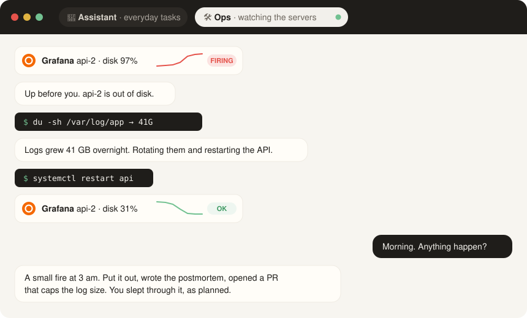

<div align="center">

<a href="https://agents-household.dev"></a>

# Household

**A home for your bots.**

Household runs each bot with a harness like Claude Code or Codex in its own sandbox,<br>
and lets you talk to it from the messenger you already use.

[](https://agents-household.dev)
[](https://agents-household.dev/docs/)
[](LICENSE)
[](#requirements)
[](#requirements)

[Quick start](#quick-start) · [Supported harnesses and messengers](#supported-harnesses-and-messengers) · [Docs](https://agents-household.dev/docs/) · [Website](https://agents-household.dev)

<br>



</div>

<br>

## ✨ Why Household

- 🔒 **Its own microVM.** Every bot runs in a separate sandbox, away from your machine and from the other bots.
- 🧰 **Build your assistants on real harnesses.** Each bot is a real Claude Code or Codex, so anything they can do, your bot can do.
- 💬 **Assistants in your messenger.** Chat with your bots in Telegram or Slack, from any device, like with anyone else.
- 🌐 **Restricted network.** A bot reaches only the hosts the workspace allows, and asks you when it needs one more.
- 🔑 **Secrets it never sees.** Each workspace owns its secrets, managed in its **Secrets** page. The bot holds only placeholders; Household puts the real keys into requests on their way out, to the hosts you chose.
- 🕵️ **Dangerous jobs go to scouts.** A bot hands risky work to a throwaway VM with only the access it needs: "find this movie on a torrent site" sends a scout onto untrusted sites without exposing the bot’s files or secrets.
- 📬 **Wakes up on its own.** Mail, feeds and alerts trigger your bots.
- ✅ **Microsoft To Do.** Share lists, tasks and checklists with selected bots: read only, asking you before each change, or with full access. [Standalone device-code sign-in](https://agents-household.dev/docs/connectors/) works on your computer or a VPS.
- ⏰ **Its own cron.** A bot schedules its own tasks: recurring ones like a weekday 9:00 digest, or one-off ones like "remind me at 18:00". Household keeps the clock on the host, across restarts.

### Supported harnesses and messengers

| Harnesses | Messengers |
|---|---|
| ✅ Claude Code | ✅ Telegram — threaded bot chats |
| ✅ Codex | ✅ Slack — bot DMs |
| 🕒 More coming soon | 🕒 More coming soon |

## 🚀 Quick start

**With your harness** — give your coding agent this prompt:

```text
Read https://agents-household.dev/llms.txt and help me set up Household on my machine.
```

**Or do it yourself:**

```sh
curl -fsSL https://agents-household.dev/install.sh | sh
house onboard   # a model key, a workspace, a Telegram or Slack channel, a first bot — step by step
house start
```

`house dashboard` signs you in to the web admin, `house update` moves to the newest release, `house --help` lists everything else.

### Requirements

| Runs on | |
|---|---|
| 🍎 Your Mac | Apple silicon |
| 🐧 Your Linux machine | with `/dev/kvm` |
| ☁️ A VM or a VPS | Linux with KVM inside: nested virtualization or a KVM-enabled VPS |

Plus `openssl` and `python3`. The installer brings the rest: microsandbox, Codex, the web UI. No Docker.

## 📚 Documentation

Connect any IMAP/SMTP mailbox from **Workspace → Connectors → + Add connector → Email**: live search, attachments, replies and sending that asks you first in the bot's chat, or sends on its own. See **[Connectors](https://agents-household.dev/docs/connectors/)**.

Everything else — bots, scouts, sideworkers, inboxes, previews, backup — is in the **[docs](https://agents-household.dev/docs/)**.
